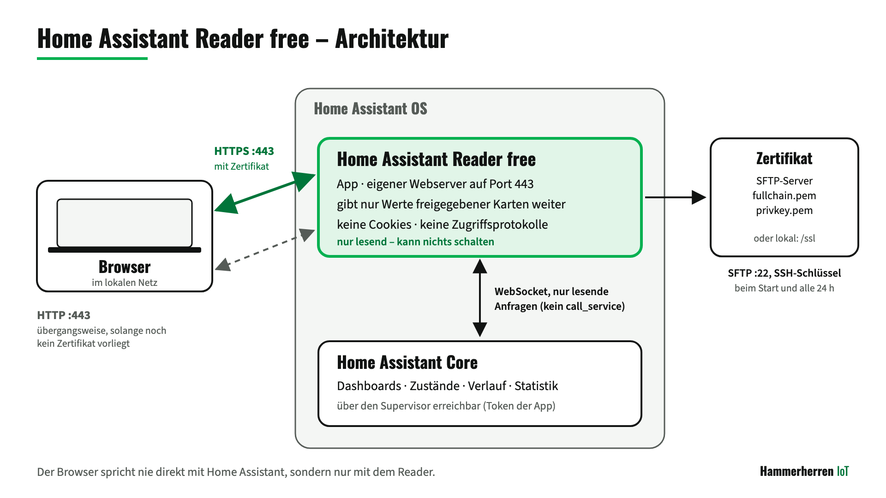

# Home Assistant Reader free

Nur lesende Ansicht ausgewählter Home-Assistant-Dashboards im Browser, ohne Zugang zu Home
Assistant selbst. Von der Hammerherren GmbH.

## So funktioniert es

- Der Reader läuft als App neben Home Assistant. Dashboards und Werte liest er über den Supervisor,
  per WebSocket und nur mit lesenden Anfragen. Schalten oder Ändern ist gesperrt.
- Für den Browser liefert er eine eigene Oberfläche auf Port 443 aus, per **HTTPS** mit Zertifikat,
  übergangsweise per **HTTP**, solange noch keines vorliegt. Der Browser spricht nie direkt mit
  Home Assistant.
- An den Browser gehen nur die Werte, die auf dem gewählten Dashboard vorkommen. Markdown-Karten
  rendert Home Assistant, der Browser erhält nur den fertigen Text.
- In der free-Version gibt es keine Anmeldung: Zugriff hat, wer den Reader im Netz erreicht.

## Was dargestellt wird

Der Reader rendert **nicht alle Karten** von Home Assistant, sondern nur die Standardkarten, und
diese nur zum Ansehen. Schalter und Tasten zeigen ihren Zustand, schalten aber nichts.

- **Entitäten** (`entities`), **Übersicht** (`glance`)
- **Kachel** (`tile`), **Sensor** (`sensor`), **Entität** (`entity`), **Taste** (`button`),
  **Licht** (`light`), **Thermostat** (`thermostat`), **Anzeige** (`gauge`)
- **Überschrift** (`heading`)
- **Markdown** (`markdown`), mit Icons über `<ha-icon icon="mdi:…">`
- **Verlaufsdiagramm** (`history-graph`), **Statistikdiagramm** (`statistics-graph`)
- **Stapel und Raster** (`vertical-stack`, `horizontal-stack`, `grid`)
- **Abschnitte-Ansichten** (`sections`)

Alle anderen Karten erscheinen als Platzhalter mit ihrem Typnamen, insbesondere
benutzerdefinierte Karten (`custom:…`, etwa aus HACS), Karte (`map`), Bildkarten (`picture…`),
Wetter, Medien und Alarm. Dashboards ohne darstellbaren Inhalt, etwa die von Home Assistant
automatisch erzeugten, werden ausgeblendet. Ein Rufzeichen rechts oben zeigt, welche das sind.

## Zertifikat einrichten

- **Ohne Zertifikat** läuft der Reader per HTTP und versucht es alle 10 Minuten erneut. Sobald ein
  passendes Zertifikat da ist, schaltet er ohne Neustart auf HTTPS.
- **Quelle `local`:** Dateien aus `/ssl`, zum Beispiel von der Let's-Encrypt-App
  (`local_fullchain`, `local_privkey`).
- **Quelle `sftp`:** Der Reader holt `fullchain.pem` und `privkey.pem` von einem Server, nur mit
  SSH-Schlüssel:
  1. App einmal starten. Der öffentliche Schlüssel steht im **Protokoll** (`ssh-ed25519 … home-assistant-reader zertabholung`).
  2. Diese Zeile auf dem Server in `authorized_keys` des SFTP-Benutzers eintragen.
  3. Den Hostschlüssel des Servers in `sftp_host_key` eintragen, z. B. aus `ssh-keyscan -t ed25519 <server>`.
     Ohne Hostschlüssel verbindet sich der Reader nicht.
  4. `sftp_host`, `sftp_user` und die Pfade der beiden Dateien eintragen.
- Das Zertifikat muss für den Namen gelten, unter dem Sie den Reader aufrufen. Abgeholt wird beim
  Start und alle 24 Stunden. Übernommen wird nur ein Paar, bei dem Schlüssel und Zertifikat
  zusammenpassen.

Alle Optionen im Detail: Reiter **Dokumentation**.

## Mehr gewünscht?

- **Home Assistant Reader Pro**: mit Benutzerverwaltung
- **Home Assistant Portal Pro**: nicht nur ansehen, sondern auch bedienen. Mit Rollen und
  Berechtigungen legen Sie genau fest, wer welche Geräte schalten darf.

Anfragen an zeilinger@hammerherren.gmbh.

---

© 2026 Hammerherren GmbH · Impressum (Ihre Angaben als Betreiber), Datenschutz und „Über diese Software“ in der Fußzeile des Readers.
